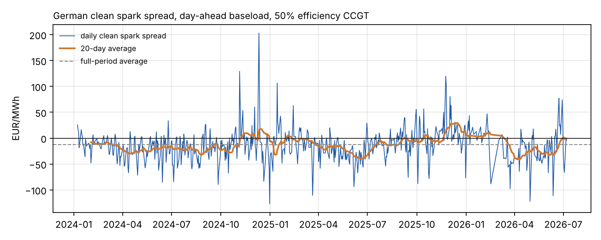

# German clean spark spread: power, gas and carbon data pipeline

A Python pipeline that joins German day-ahead power, TTF gas and EUA carbon prices and computes the
clean spark spread, the generation margin of a benchmark gas-fired power plant after fuel and carbon
costs. It then measures where the margin sits in its range and which leg is driving it.

## Headline results (Bloomberg data, 8 Jan 2024 to 7 Jul 2026)

- **Structurally negative.** Over 620 common trading days the spread averaged **-EUR 12.38/MWh**, and a
  benchmark plant ran at a spot loss on 70% of days.
- **Recovering, but still below zero.** The latest print is **-EUR 4.40/MWh**, inside the upper quartile
  of the normal range (middle 50% of days from -EUR 29.81 to +EUR 2.37/MWh).
- **Power-led.** Over the last 20 trading days against the full-period average, power rose
  **+EUR 26.7/MWh** against **+EUR 13.0** for the gas cost and **+EUR 2.0** for carbon, so the firming is
  a power story, not a fuel or carbon one.

Full tables are in [`results/results.md`](results/results.md).



## Method

```
clean spark spread = power - gas / 0.50 - carbon x 0.37        (EUR per MWh of electricity)
```

- **Benchmark plant.** A standard combined-cycle gas turbine at 50% efficiency and 0.37 tCO2/MWh, a market
  convention rather than a specific asset. Both sit inside the usual CCGT ranges (about 49-60% and
  0.36-0.41 tCO2/MWh).
- **Data.** DE day-ahead baseload (ELGBDAHD BCFV Index), TTF front-month (TTFG1MON BCFV Index) and EUA
  Dec-26 (EEUAM Z26 Index), pulled from a Bloomberg Terminal.
- **Date join.** The three legs trade on slightly different calendars, so they are inner-joined on dates
  where all three settled. Six non-common days are dropped, so every spread is built from three same-day
  prices.
- **Day-ahead rather than futures.** Spot power avoids contract-roll jumps, at the cost of noisier daily
  values with scarcity spikes and negative-price days. That is why the median and middle 50% are the
  better read of a typical day than the full range.
- **Driver split.** Recent average minus full-period average for each leg, converted to EUR per MWh of
  power. The three changes add up exactly to the change in the spread.

## Reproduce

```
pip install -r requirements.txt
python3 make_sample_data.py     # synthetic sample, since Bloomberg data cannot be redistributed
python3 spark_spread.py         # writes results/results.md and results/spread.png
python3 -m pytest -q tests
```

To run on real data, put `power.csv`, `gas.csv` and `carbon.csv` (columns `date,price`) in `data/`.

## Limits

The spread is a market indicator for a hypothetical plant, not any operator's realised P&L. It ignores
variable operating costs, start-up costs, plant availability and hedging, all of which matter for a real
generator's margin.
