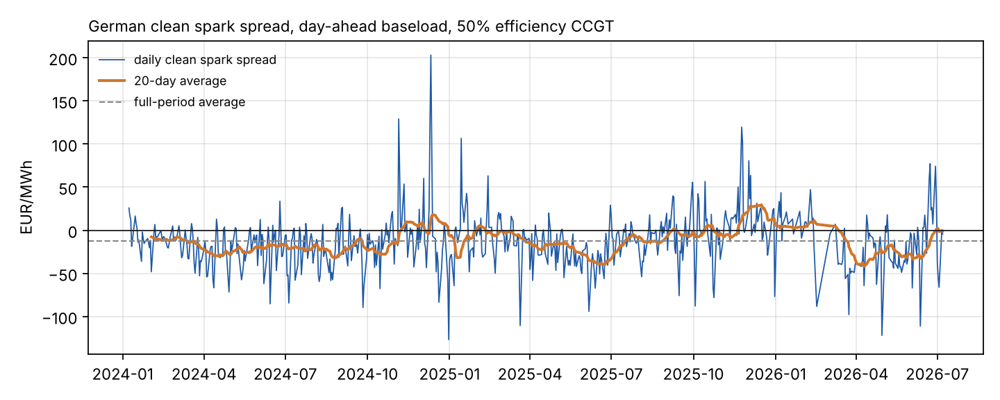

# Results

620 common trading days from 08 Jan 2024 to 07 Jul 2026, 6 non-common days dropped. Benchmark plant 50% efficient, 0.37 tCO2/MWh.

## Where the spread sits (EUR/MWh)

| metric | value |
|---|---|
| current | -4.40 |
| average | -12.38 |
| median | -10.94 |
| middle 50% of days | -29.81 to +2.37 |
| full range | -126.80 to +203.04 |
| share of days negative | 70% |

## What moved it, last 20 days against the full-period average (EUR/MWh of power)

| leg | change |
|---|---|
| power | +26.66 |
| gas cost | +12.96 |
| carbon cost | +2.00 |
| spread (power - gas - carbon) | +11.70 |

